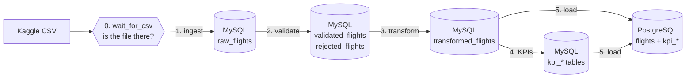

# Report: Flight Price Analysis with Apache Airflow

**Author:** Christine Umutoni

## 1. Goal

Build an end-to-end pipeline that loads Bangladesh flight price data, checks its quality,
calculates key performance indicators (KPIs) and stores the results in PostgreSQL for analysis.
Airflow orchestrates the steps: it runs them in the right order, retries a failed task, and shows
the status and logs of every task.

## 2. Pipeline architecture

- **MySQL is the staging area:** it keeps a copy of the CSV (with column names and data types
  standardized, so it is easier to process) and every intermediate step, so I can check each step on its own.
- **PostgreSQL is the analytics database:** it only receives clean, final data.
- Everything runs in **Docker** (MySQL, PostgreSQL and Airflow containers), because Airflow does
  not run directly on Windows.
- Tasks pass data through database tables, not through Airflow (XCom), because XCom is meant for
  small messages, not thousands of rows.

## 3. The DAG and its tasks

DAG `flight_price_analysis` (`dags/flight_price_dag.py`): started by hand (`schedule=None`),
`catchup=False`, every task retries 2 times with 1 minute between tries.

`wait_for_csv >> ingest_csv_to_mysql >> validate_data >> transform_data >> calculate_kpis >> load_to_postgres`

The first task is a **sensor** (it waits); the other five are **PythonOperators** (they do the work).

| Task | File | What it does |
|---|---|---|
| `wait_for_csv` | `dags/flight_price_dag.py` | PythonSensor. Every 60 seconds it checks that the CSV exists and is not empty. When it is ready, the pipeline continues. After 2 hours without the file it fails, so the next tasks never run on missing data. `mode="reschedule"` frees the worker between checks. |
| `ingest_csv_to_mysql` | `src/ingest_data.py` | Reads the CSV, standardizes the column names, converts numbers and dates, empties `raw_flights` and inserts all rows. Stops with an error if the row count in MySQL is not the same as in the CSV. |
| `validate_data` | `src/validate_data.py` | Checks the 6 required columns exist. Cleans text (spaces, empty text, airport codes in capitals, same spelling for names that only differ in capital letters). Flags rows with a missing airline, source or destination, a missing or non-numeric base fare or tax, negative fares, invalid airport codes, same source and destination, or duplicates. A missing total fare is not rejected: the next task calculates it. Good rows go to `validated_flights`, bad rows with their reason to `rejected_flights`. |
| `transform_data` | `src/transform_data.py` | Calculates `base_fare + tax_surcharge`. Fills `total_fare` when it is missing, and flags (does not overwrite) rows where the given total is different. Adds `route` (e.g. DAC-CXB) and `season_type`: Regular = Non-Peak; Winter Holidays, Hajj and Eid = Peak; a missing or unknown label stays empty (with a warning), so it is never counted as Peak by mistake. |
| `calculate_kpis` | `src/calculate_kpis.py` | Calculates the four KPIs and saves them as `kpi_*` tables. |
| `load_to_postgres` | `src/load_data.py` | Copies the flights and KPI tables to PostgreSQL in **one transaction** and checks the row counts before committing, so PostgreSQL never has half-loaded data. |

**Running the DAG again is safe:** each task empties or replaces its output table first, so there are no duplicates.
I checked this: after running the DAG twice, PostgreSQL still has exactly 57,000 flights (not 114,000).

## 4. KPI definitions and logic

| KPI | Definition | Logic | Table |
|---|---|---|---|
| Average fare by airline | Mean total fare (BDT) per airline | `groupby("airline")` → mean of `total_fare` | `kpi_airline` |
| Seasonal fare variation | Average fare per season, and peak vs non-peak | `seasonality` "Regular" = Non-Peak; Winter Holidays, Hajj and Eid = Peak; unknown labels left out. Mean fare per season, and % difference from the non-peak average | `kpi_season`, `kpi_peak` |
| Booking records by airline | Number of booking records per airline (not real demand: one row = one record) | `groupby("airline")` → count | `kpi_airline` |
| Most frequent routes | Top 10 source-destination pairs by number of booking records | `groupby(["source", "destination"])` → count, sorted from highest | `kpi_route` |

Note: the dataset has no booking ID, so **one row = one booking**.

## 5. Results

The whole DAG ran successfully in about 1 minute 20 seconds.

**Data quality**

| Check | Result |
|---|---|
| Rows in the CSV | 57,000 (17 columns) |
| Rows rejected by validation | 0 |
| Rows loaded into PostgreSQL `flights` | 57,000 - no row lost |
| Total fare different from base fare + tax (more than 1 BDT) | 2,522 rows (about 4.4%), kept and flagged in `fare_mismatch` |

**KPIs**

| KPI | Result |
|---|---|
| Average fare by airline | Highest: Turkish Airlines, about 75,547 BDT. Lowest: Vistara, about 68,108 BDT. Only about 10% difference between the 24 airlines. |
| Booking records by airline | US-Bangla Airlines has 4,496 records, about double every other airline (about 2,200 - 2,370 each). This shows how often each airline appears in the dataset, not necessarily real customer demand. |
| Seasonal fare variation | Peak: 81,570 BDT (12,475 records). Non-peak: 68,077 BDT (44,525 records): about 20% higher in peak. By season: Hajj 97,144 BDT (+42.7%, 942 records), Eid 91,560 BDT (+34.5%, 603), Winter Holidays 79,677 BDT (+17.0%, 10,930). This is an observed difference in averages, not proof that the season causes the higher price. |
| Most frequent routes | 1. RJH-SIN (Rajshahi - Singapore) 417, 2. DAC-DXB 413, 3. BZL-YYZ 410. The top 10 are very close (403 - 417 records), and routes with the same count can swap places between runs. 8 of the top 10 are international (about 100,000 - 114,000 BDT); the 2 domestic ones cost about 7,500 BDT. |

## 5b. Testing

**Mini test** (`src/mini_test_demo.py`, `data/mini_test_flights.csv`): the real dataset has no invalid rows,
so I made 11 test flights to prove the checks work. The script runs my real validation and transformation
functions on them.

| Row | Test | Result |
|---|---|---|
| 1, 2, 3 | normal flights | valid (rows 2 and 3 are Peak: Eid, Winter Holidays) |
| 4 | base fare -500 | rejected: negative base_fare |
| 5 | total fare missing | valid, total filled with 12,000 + 2,000 = 14,000 |
| 6 | copy of row 2 | rejected: duplicate row |
| 7 | 10,000 + 2,000 but total 20,000 | valid, flagged as fare mismatch |
| 8 | no airline | rejected: missing airline |
| 9 | source written "Dhaka" | rejected: invalid source code |
| 10 | CXB to CXB | rejected: source equals destination |
| 11 | season label "Ramadan" (unknown) | valid, but season_type left empty, with a warning (not counted as Peak) |

Result: 6 valid, 5 rejected, 1 fare mismatch, 1 unknown season - exactly what I expected.

**Other checks:** row counts are compared after ingestion and after loading; running the DAG twice still gives 57,000 rows.

## 6. Challenges and how I solved them

*To update while building the lab.*

| Challenge | Solution |
|---|---|
| Airflow does not run directly on Windows | Run Airflow, MySQL and PostgreSQL in Docker with `docker-compose.yml` |
| Inside Docker, `localhost` means the container itself, not my PC | Use the container names (`mysql`, `postgres`) as host names in `.env` |
| My own MySQL and PostgreSQL already use ports 3306 and 5432 | The containers use ports 3307 and 5433 on my PC |
| pandas and SQLAlchemy versions must work together (newer pandas gave `'Engine' object has no attribute 'cursor'`) | Pin the same versions as the Airflow 2.10.5 image in `requirements.txt` |
| The CSV column names are not exactly the lab names (e.g. `Base Fare (BDT)`) | One rename table (`COLUMN_NAMES`) in `ingest_data.py` |
| MySQL stores True/False as 1/0, PostgreSQL needs real booleans | Convert `fare_mismatch` with `astype(bool)` before loading |
| The data could arrive late, and the first version failed after only 2 quick retries | Added the `wait_for_csv` sensor: it checks every minute for up to 2 hours |
| In the real data no row is invalid, so I could not show that validation works | Made a mini test file with 10 rows, each with a different problem |
| Some airport names contain a comma inside quotes (e.g. "Netaji Subhas Chandra Bose International Airport, Kolkata") | Read the CSV with pandas, which handles quotes correctly |

## 7. Limitations

- One row is counted as one booking (no booking ID in the data).
- Peak / non-peak depends on the `Seasonality` labels in the dataset. Only the 4 known labels are classified;
  a new label is left empty with a warning, and must be added to the list in `transform_data.py`.
- Fares are in BDT and are not adjusted for inflation.
- The dataset has no cancellations, refunds or date changes. In real life these happen, and the KPIs
  would then need a booking-status column (to leave out cancelled tickets), the refund amount, and
  incremental loads that update a changed booking instead of adding it again. I did not add this to the
  code, because I did not want to invent data that is not in the dataset.
- The top 10 routes have almost the same number of booking records (403 - 417), which often happens with
  generated Kaggle data, so this KPI alone should not be used for business decisions.
- Airflow runs in standalone mode (SQLite + SequentialExecutor). That is fine for development; in
  production I would use PostgreSQL for Airflow's own database and LocalExecutor or CeleryExecutor.
- Alerts go to `data/alerts.log`, and to Slack only if a webhook is set in `.env`; there is no email alert.
- The 2,522 fare mismatches are flagged but not explained yet; this needs more investigation.

## 8. Conclusion

The pipeline loads 57,000 Bangladesh flights from CSV into MySQL staging, checks and transforms them,
calculates four KPIs and stores everything in PostgreSQL, with no row lost. Airflow runs the six tasks in
order, waits for late data, retries failed tasks and shows every step, and the pipeline can be run again
safely. The main findings: peak-season flights have about 20% higher average fares than non-peak flights, US-Bangla
Airlines has about twice as many booking records as any other airline, and about 4.4% of flights have a total
fare that does not match base fare + tax.
